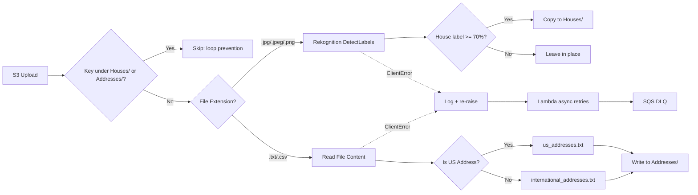
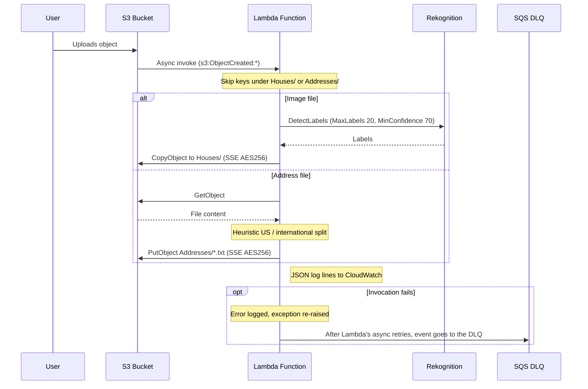

# AWS Serverless Image Classifier

An event-driven pipeline on AWS. Files dropped into an S3 bucket trigger a Lambda function that:

- **Images** (`.jpg`/`.jpeg`/`.png`, the formats Rekognition accepts): sends them to Amazon Rekognition and copies anything recognized as a house to `Houses/`.
- **Address files** (`.txt`/`.csv`, one address per line): splits addresses into US and international lists and writes them to `Addresses/`.

Everything is provisioned with Terraform, logged as structured JSON to CloudWatch, alarmed by email, and backed by an SQS dead-letter queue for failed invocations.

**Stack:** Python 3.12 · AWS Lambda · S3 · Rekognition · SQS · SNS · CloudWatch · IAM · Terraform · pytest

## Repository layout

```
├── lambda_function.py   # the classifier (single-file Lambda)
├── terraform/main.tf    # all infrastructure
├── tests/test_lambda.py # post-deploy audit report against the live bucket
├── assets/              # sample images and a sample address file (test.txt)
└── requirements.txt     # local dependencies for running the tests
```

## How it works





### Image classification

`_process_image` calls `DetectLabels` with `MaxLabels=20` and `MinConfidence=70` (`lambda_function.py:103-107`). If any returned label is in `HOUSE_LABELS` (`House`, `Housing`, `Home`, `Cottage`, `Villa`, `Building`, `Architecture`, `Neighborhood`, `Suburb`, `Residential Building`, `Single Family Residence`), the image is copied to `Houses/<filename>`. The original is never moved or deleted.

### Address classification

`_is_us_address` is a heuristic, not a model:

1. If the line names a known non-US country (UK, France, Germany, Japan, Canada, and others in `NON_US_COUNTRIES_RE`), it is international.
2. If it contains `USA`, `U.S.A.` or `United States`, it is US.
3. If it contains an uppercase two-letter US state or DC abbreviation, at the start of the line or after a space or comma, that is followed by a ZIP code or ends the line (`Springfield, IL 62704`, `Washington DC`), it is US. The match is case-sensitive, so words like "de" or "in" do not count.
4. Otherwise it is international.

Each address file overwrites `Addresses/us_addresses.txt` and `Addresses/international_addresses.txt`. A list with no entries is not written.

## Setup and deploy

Prerequisites: Terraform 1.5 or later, AWS CLI v2 with credentials configured (`aws configure`), and Python 3.12 for the tests.

```bash
cd terraform
terraform init
terraform apply \
  -var="alert_email=you@example.com" \
  -var="bucket_name=<a-globally-unique-bucket-name>"
```

Variables (`terraform/main.tf:18-33`):

| Variable      | Default                      | Notes                                   |
|---------------|------------------------------|-----------------------------------------|
| `aws_region`  | `us-west-2`                  |                                         |
| `bucket_name` | `image-classifier-processor` | S3 names are global; override this      |
| `alert_email` | (required)                   | Receives CloudWatch alarm notifications |

After `apply`, confirm the SNS subscription email AWS sends to `alert_email`, otherwise alarms are not delivered. Terraform outputs the bucket name, Lambda function name and DLQ URL.

### Try it

```bash
aws s3 cp ../assets/ s3://<bucket_name>/ --recursive
aws s3 ls s3://<bucket_name>/Houses/
aws s3 cp s3://<bucket_name>/Addresses/us_addresses.txt -
```

Logs are in the `/aws/lambda/image-classifier-processor` log group.

### Tear down

Versioning is enabled on the bucket, so empty it (including old versions) before `terraform destroy`.

## Tests

`tests/test_lambda.py` is a post-deploy audit, not a unit-test suite. It reads the live bucket and prints which sample images landed in `Houses/` and how `test.txt` was split. It makes no assertions, so it passes as long as it runs.

```bash
pip install -r requirements.txt
# upload assets/ first (see "Try it"), then:
pytest tests/ -s
```

The bucket name and region are hard-coded in the test (`BUCKET_NAME = "image-classifier-processor"`, `REGION = "us-west-2"`). Edit them if you deployed with different values.

### Sample results

Images (as recorded from a run against the sample assets; Rekognition results can vary):

| Copied to `Houses/` | Not copied |
|---|---|
| nonConv.jpg, animated.jpg, control.jpg, scaff.jpg, row.jpg, houseInterior.jpg | dum.png, modelMini.jpg, dice.jpg, giraffe.jpg, tameImpala.jpg |

`houseInterior.jpg` is an interior shot and still counts as a house, because broad labels like `Building` and `Architecture` are in the match set.

Addresses from `assets/test.txt` (27 lines) with the current code: 11 US, 16 international.

```
--- USA LIST (11 addresses) ---
  123 Main St, Los Angeles, CA 90001
  456 Oak Avenue, San Francisco, CA 94102
  1600 Amphitheatre Parkway, Mountain View, CA 94043
  350 5th Ave, New York, NY 10118
  1 Apple Park Way, Cupertino, CA 95014
  500 Terry A Francois Blvd, San Francisco, CA 94158
  CA 90210 Beverly Hills Missing Street Order
  742 Evergreen Terrace, Springfield, IL 62704
  1600 Pennsylvania Ave NW, Washington, DC 20500
  1600 Pennsylvania Ave NW Washington DC
  1234 Random Blvd USA
```

"Plaza de Mayo, Buenos Aires C1064, Argentina" goes to international: Argentina is not in the non-US country list, but "de" no longer matches `DE` (Delaware) because state codes must be uppercase and next to a ZIP or at the end of the line. "No ZIP Code Address, Some City, California" goes to international because full state names are not recognized.

## Design notes

### Monitoring and observability

- **Structured JSON logging:** every log line is a JSON object (`log()` in `lambda_function.py:13-16`) with fields such as `key`, `matched_labels`, `us` and `international`, so CloudWatch Logs Insights can filter and aggregate on them.
- **Alerting:** a CloudWatch alarm on the Lambda `Errors` metric fires when the sum exceeds 2 in a single 60-second period, and notifies the SNS email subscription (`terraform/main.tf:219-236`).
- **Dead-letter queue:** S3 invokes Lambda asynchronously. When an invocation fails, Lambda retries it, and if it still fails the event is sent to the SQS DLQ (`image-classifier-dlq`, 14-day retention, SSE with the AWS-managed SQS key). Failed events can then be inspected and replayed.
- **Log retention:** 30 days.

### Security

- **IAM scoping:** the Lambda role can only write its own log stream, `s3:GetObject`/`s3:PutObject` on objects in this one bucket, call `rekognition:DetectLabels`, and `sqs:SendMessage` to the DLQ. It has no delete permission and no access to other buckets. (`rekognition:DetectLabels` is granted on `*` because the action does not support resource-level scoping.)
- **Public access block:** all four S3 public-access settings are enabled:

  ```hcl
  resource "aws_s3_bucket_public_access_block" "main" {
    bucket                  = aws_s3_bucket.main.id
    block_public_acls       = true
    block_public_policy     = true
    ignore_public_acls      = true
    restrict_public_buckets = true
  }
  ```

- **Encryption at rest:** the bucket has default SSE-S3 (AES256) encryption with bucket keys, and the Lambda also sets `ServerSideEncryption="AES256"` explicitly on every object it writes.
- **Versioning:** enabled on the bucket, so overwritten output files can be recovered.
- **No secrets in code:** configuration comes from Terraform variables, and AWS credentials come from the local AWS CLI profile.

### Production concerns

- **Loop prevention:** the S3 trigger has no prefix filter, so the function's own writes to `Houses/` and `Addresses/` also invoke it. The handler skips any key under those prefixes before doing work (`lambda_function.py:71-73`), which prevents an infinite trigger loop.
- **Scaling:** S3-triggered Lambda scales out per upload without any extra configuration. Image and address processing share one function, so a spike in one competes with the other for concurrency.
- **Error handling:** calls to S3 and Rekognition are wrapped so that a `ClientError` is logged with its AWS error code and then re-raised. Re-raising is deliberate: it marks the invocation as failed so that Lambda retries it and, if needed, routes it to the DLQ and counts it toward the alarm.

## Known limitations

- **Address heuristic:** a line ending in an uppercase two-letter code that happens to be a state (for example "Meet me in LA") still counts as US. Full state names, lowercase state codes and ZIP-only addresses are not recognized.
- **Output overwrites:** each address file replaces the previous `Addresses/` outputs instead of appending, and an empty list leaves the previous file in place.
- **Filename collisions:** images are copied to `Houses/<filename>`, so `a/house.jpg` and `b/house.jpg` overwrite each other.
- **Image formats:** only `.jpg`, `.jpeg` and `.png` are processed. Other image types (`.gif`, `.webp`, `.heic` and so on) are logged as unsupported and skipped, not converted.
- **Batch failure:** if one record in an event fails, the remaining records in that event are not processed in that attempt.

## Future work

- **CI/CD:** automated `terraform plan` on pull requests, plus canary deployments with automatic rollback.
- **Address validation:** verify addresses against USPS data (for example through Smarty or Lob) instead of the heuristic.
- **Malware scanning:** scan uploads before processing. The function is not in a VPC, so least-privilege IAM is the main containment today, not network isolation.
- **SQS buffer and concurrency control:** put SQS between S3 and Lambda (`S3 -> SQS -> Lambda`) and cap Lambda concurrency to stay under Rekognition's TPS limits.
