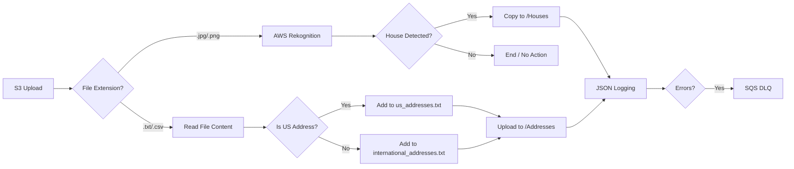
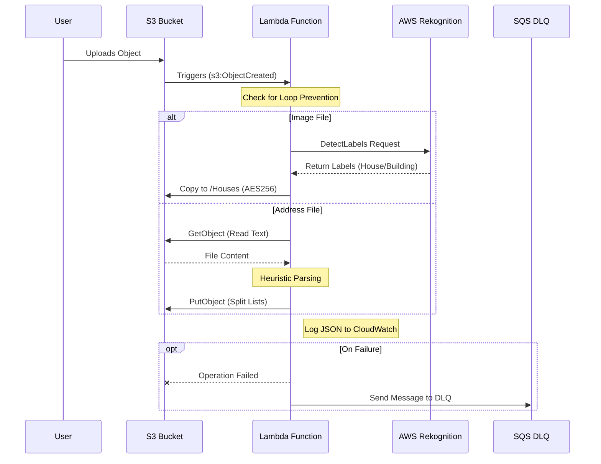

# AWS Serverless Image Classifier

An event-driven pipeline on AWS. Files dropped into an S3 bucket trigger a Lambda function that:

- **Images** (`.jpg`/`.png`): sends them to Amazon Rekognition and copies anything recognized as a house to `Houses/`.
- **Address files** (`.txt`/`.csv`): splits addresses into US and international lists and writes them to `Addresses/`.

Everything is provisioned with Terraform, logged as structured JSON to CloudWatch, alarmed by email, and backed by an SQS dead-letter queue for failures.

**Stack:** Python · AWS Lambda · S3 · Rekognition · SQS · CloudWatch · IAM · Terraform · pytest

## Repository layout

```
├── lambda_function.py   # the classifier
├── terraform/main.tf    # all infrastructure
├── tests/test_lambda.py # end-to-end audit tests
├── assets/              # sample images and addresses
└── requirements.txt
```

## Overall Hierarchy 



## AWS User Sequence Flow Chart

## Test Output

```
========================= IMAGE AUDIT =========================
✅ [HOUSE]      nonConv.jpg          -> Labels: Villa (100.0%), Pool (100.0%), Swimming Pool (99.9%)
✅ [HOUSE]      animated.jpg         -> Labels: Cottage (100.0%), House (100.0%), Housing (100.0%)
❌ [NON-HOUSE]  dum.png              -> Reason: No house labels > 70% confidence
❌ [NON-HOUSE]  modelMini.jpg        -> Reason: No house labels > 70% confidence
✅ [HOUSE]      control.jpg          -> Labels: Neighborhood (99.2%), Garage (97.5%), Suburb (95.5%)
✅ [HOUSE]      scaff.jpg            -> Labels: Wood (100.0%), Nature (98.0%), Outdoors (98.0%)
✅ [HOUSE]      row.jpg              -> Labels: Neighborhood (100.0%), Housing (98.8%), City (98.4%)
❌ [NON-HOUSE]  dice.jpg             -> Reason: No house labels > 70% confidence
❌ [NON-HOUSE]  giraffe.jpg          -> Reason: No house labels > 70% confidence
✅ [HOUSE]      houseInterior.jpg    -> Labels: Home Decor (99.3%), Couch (99.3%), Interior Design (98.9%)
❌ [NON-HOUSE]  tameImpala.jpg       -> Reason: No house labels > 70% confidence
PASSED
test_lambda.py::TestFinalSystemAudit::test_address_classification_results 
======================== ADDRESS AUDIT ========================

--- USA LIST (13 addresses) ---
  • 123 Main St, Los Angeles, CA 90001
  • 456 Oak Avenue, San Francisco, CA 94102
  • 1600 Amphitheatre Parkway, Mountain View, CA 94043
  • 350 5th Ave, New York, NY 10118
  • 1 Apple Park Way, Cupertino, CA 95014
  • 500 Terry A Francois Blvd, San Francisco, CA 94158
  • Plaza de Mayo, Buenos Aires C1064, Argentina ❌
  • 123 Fake Street, Springfield ZZ 99999 ❌
  • CA 90210 Beverly Hills Missing Street Order
  • 742 Evergreen Terrace, Springfield, IL 62704
  • 1600 Pennsylvania Ave NW, Washington, DC 20500
  • 1600 Pennsylvania Ave NW Washington DC
  • 1234 Random Blvd USA

--- INTL LIST (14 addresses) ---
  • 221B Baker Street, London NW1 6XE, UK
  • 10 Downing Street, London SW1A 2AA, United Kingdom
  • Champs-Élysées, 75008 Paris, France
  • 29 Rue de Rivoli, 75004 Paris, France
  • Potsdamer Platz 1, 10785 Berlin, Germany
  • Shibuya Crossing, Tokyo 150-0002, Japan
  • 1 Marina Bay Sands, Singapore 018956
  • Sydney Opera House, Bennelong Point, Sydney NSW 2000, Australia
  • Kremlin, Moscow 103073, Russia
  • 1000 Rue Sherbrooke O, Montréal, QC H3A 1G5, Canada
  • No ZIP Code Address, Some City, California
  • Invalid Address Without Proper Format
  • Eiffel Tower, Paris
  • Colosseum, Rome, Italy

===============================================================

```

We can see the two incorrectly defined addresses being classified as a US address this is to highlight the limitations of the model in that all countries have to be completely defined and the zip-code system is too basic to catch that `123 Fake Street, Springfield ZZ 99999` ZZ is not a real state thus the fact that it has a Zip Code shouldn't matter. *Further production grade implementation would include a connection to USPS database of address using Smarty or Lob API. (see "Better address checking" below)*

# Design notes

  

## 1. Monitoring & Observability

I implemented a multi-layered monitoring strategy to ensure the system is "self-describing" in production:

*  **Structured JSON Logging:** 
Since the regular logs are often verbose, a standard practice for me was to always put in place some formatting and filtering to be able to better define logs. The use of JSON to format logs also allows me to make queries such as find the images where confidence was over a certain threshold etc. 

*  **Proactive Alerting:**
A CloudWatch alarm triggers an Email alert when more than 2 errors show up in a 60 minute span. Allowing you to run the program with a batch of images and let it run with perfect reliability and notification if something doesn't work.


*  **Dead Letter Queue (DLQ):** 
A method for reliability allows us to preserve certain issues so that we can go back to each one and be able to debug and recreate the issue so that it doesn't happen again

  

## 2. Security - Least Privilege 


*  **IAM Scoping:** The Lambda execution role is restricted to only the necessary actions (`s3:GetObject`, `s3:PutObject`, `rekognition:DetectLabels`). It cannot delete objects or access other buckets.

*  **Public Access Block:**  The s3 bucket is specifically barred from accessing anything public with 
```
resource "aws_s3_bucket_public_access_block" "main" {
bucket = aws_s3_bucket.main.id
block_public_acls =  true
block_public_policy =  true
ignore_public_acls =  true
restrict_public_buckets =  true
}
```

*  **Encryption at Rest:** All processed files automatically use AES256 server-side encryption (faster than RSA and more usable for the small case data we expect to handle) during `s3:GetObject`, `s3:PutObject`.

*  **Environment Safety:** No secrets even touch the code, every part of the infrastructure config is handled through terraform variables, and we use AWS CLI to handle AWS credential login using the browser (this proved very unreliable so I had to generate a key instead of using browser login ie. `aws configure` instead of `aws login`.
  

## 3. Production Concerns

*  **Idempotency & Loop Prevention:**  An issue I ran into when working with event-driven properties is the point of infinitely looping. Say if we write to say the `Houses/` file, due to the event-driven nature of the system Rekognition and lambda can look at this as a reason to execute the program again, resulting in infinite loops and major compute loss. Thus we always check the folder we're in to make sure that we don't run anything in that specific folder to then trigger that same folder (`Houses/` or `Addresses/`)

*  **Concurrency & Scaling:** By using an event-driven architecture, the system scales horizontally automatically. If 1,000 images are uploaded at once, AWS manages the Lambda scaling to match demand. For future reference we could run two independent instances, one for houses and one for addresses thus allowing a spike in one category not to affect another

*  **Error Handling:** The code uses `try-except` blocks around external service calls (S3/Rekognition) to catch `ClientError` exceptions, ensuring that API issues are logged without crashing the process.


## 4. To Implement / For Production TODO


*  **CI/CD:**  Making a Canary deployment to test newer versions with portions of traffic, as well as implementing automated rollback in case the pipeline gets upgraded or becomes *much* more complex in the future. 
*  **Better Address Checking (Real World):** Since right now the only way to validate if an address is in the USA is to use `is_us_address` which is not an AI model but a heuristic / context based classifier the best way to be completely accurate would be to connect with the USPS database and reference against real-world addresses. *The only reason the implementation is rudimentary is because I did not know the quality of data I would be getting.*
* **Malware Injection (HIGH PRIORITY):**  Not yet implemented: one of the biggest issues with systems like this is malware injection, in which I would scan each file to prevent malware from entering the s3 buckets. However the IAM Least Privileges and no access to the internet can mitigate this blast radius.
* **SQS Buffer and Concurrency Control:** Something I did during my time working as the Lead Infra Engineer was to use an SQS buffer between `s3 -> Lambda ` to prevent API Throttling (`s3 -> SQS -> Lambda`). Further would also like to implement concurrency control to keep under rekognition's TPS Limits and prevent it from being overwhelmed
